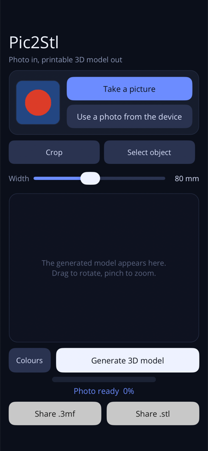
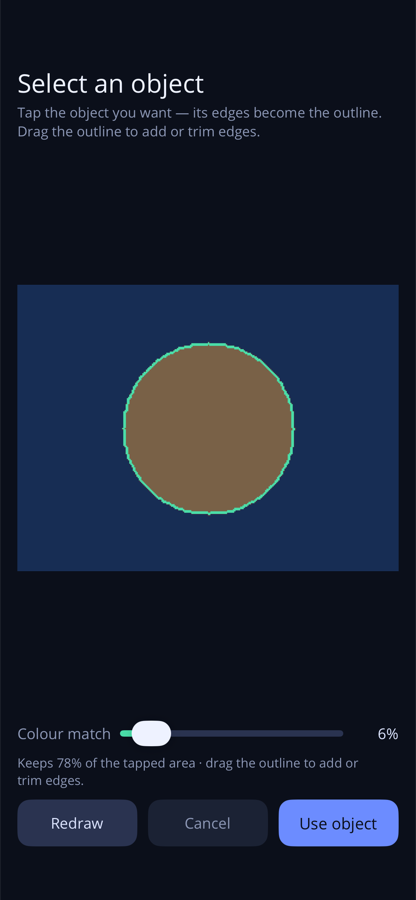
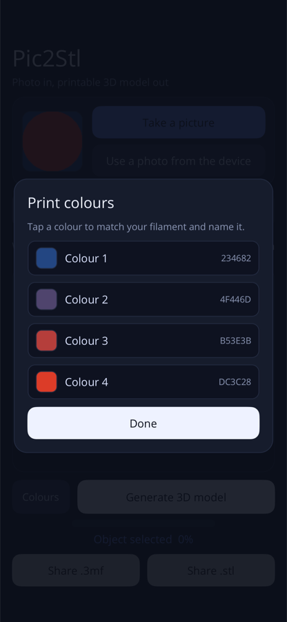
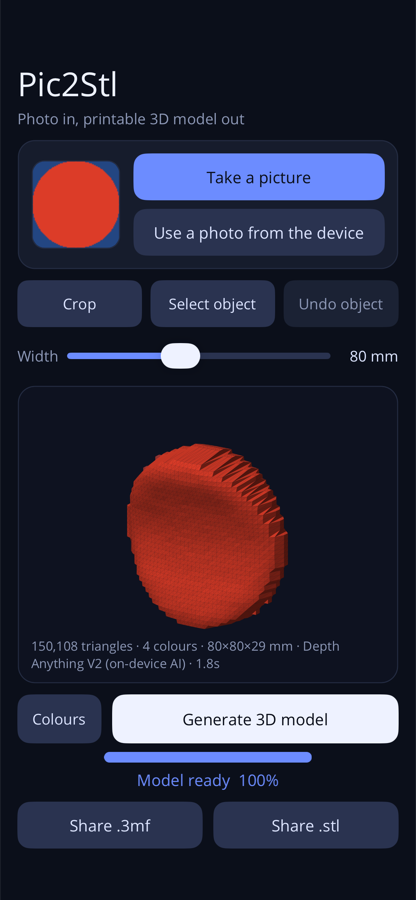

# Pic2Stl

Turn a photo into a printable, multi-colour 3D model, on the device. Point the
app at a picture, tap the thing you want to keep, say which filaments are loaded,
and get an STL for the shape and a 3MF whose colours arrive in a slicer as
separate spools.

Everything runs on the phone: the depth estimation, the meshing and the export.
No photo leaves the device and nothing is sent to a service.

## Screenshots

<table>
  <tr>
    <td width="25%"></td>
    <td width="25%"></td>
    <td width="25%"></td>
    <td width="25%"></td>
  </tr>
  <tr>
    <td>Choose a photo</td>
    <td>Tap the object; drag its outline to trim</td>
    <td>Pick and name your filaments</td>
    <td>Generate, then share .3mf or .stl</td>
  </tr>
</table>

Captured on an iPhone by the app's debug walkthrough (`P2S_SNAPSHOT=1`), which
runs on a synthetic red-on-blue test photo so every run looks the same.

## What it does

- **Pick the object with a tap.** The object is grown from the pixel you touch,
  and its outline is drawn over the photo. Dragging that outline adds or trims
  edges with a brush; the found object can be tuned with a strictness slider.
- **Print in your own colours.** The print colours are the filaments you have,
  named by you and kept between launches, and the photo is mapped onto them
  rather than onto colours found in the picture.
- **Depth from AI.** [Depth Anything V2 Small](https://huggingface.co/onnx-community/depth-anything-v2-small),
  quantised and run locally with ONNX Runtime, turns the photo into a depth
  field. A heuristic estimator is bundled as a fallback.
- **A solid, not a relief.** The depth field becomes a closed solid: a front
  relief, a guessed mirrored back, and a rim that closes the two together.
- **Exports that behave in a slicer.** The STL is one watertight solid for the
  shape. The 3MF is built colour by colour, with each colour closed as its own
  solid and given its own spool in `Metadata/model_settings.config`, which is
  what slicers such as ElegooSlicer and Orca actually read. No print settings are
  written into the file, so the profile you chose is left alone.

## Using it

1. **Take a picture**, or **Use a photo from the device**.
2. **Select object** and tap the subject. The found outline is drawn over the
   photo; the **Colour match** slider decides how far it follows the object into
   its background, and dragging the outline adds or trims edges. **Apply** keeps
   it. **Crop** is there when a plain rectangle is all you need. **Undo** takes
   back one edit at a time.
3. **Print colours** sets how many colours to print (1 to 16, four by default),
   and lets you pick and name each one to match the spools you actually load. The
   photo is mapped onto those colours, not onto colours invented from the image.
4. **Width** sets the size across the finished object: 30 to 150 mm, 80 mm by
   default. Height follows the photo's aspect ratio.
5. **Generate 3D model**, look at it (drag to rotate, pinch to zoom), then
   **Share .3mf** or **Share .stl**. Files are also kept in the app's own
   `exports` folder.

## What you get

| File | Contents |
| --- | --- |
| `.stl` | One watertight solid. No colour, no parts. |
| `.3mf` | The same model split by colour, every colour closed as its own solid, with the spool assignment written in. |

Multi-colour 3MFs carry one mesh object per colour plus an assembly object, so
colours stay in place instead of being scattered across the plate.
`Metadata/model_settings.config` maps each part to an extruder, which is what
Orca and ElegooSlicer read to put each colour on its own spool. The file
contains no `project_settings.config` on purpose: a partial profile overrides
whatever the slicer already has.

## Slicing the result

- Load the 3MF and you should see one part per colour. Set up that many
  filaments; colour 1 goes to spool 1 and so on.
- Do not merge or "repair" the parts, and decline any offer to import print
  settings from the file. Leave the profile you already use.
- If the slicer refuses with *"Relative extruder addressing requires resetting
  the extruder position ... Add G92 E0 to layer_gcode"*, the model is not at
  fault: that is a printer profile using relative E with no per-layer reset.
  Use a profile with absolute E, or add `G92 E0` to its before-layer-change
  g-code. Do not add it to an absolute-E printer, where zeroing the counter
  mid-print would skip extrusion at every layer.

## What it cannot know

- Depth comes from a single photo, so it is a good guess rather than a
  measurement. Reflections, glass, thin structures and flat-background cut-outs
  mislead it.
- The back of the model is guessed: the relief is mirrored at 45% and closed by
  a rim, on a base at least 2.5% of the width thick.
- Selection finds one subject at a time. A busy scene needs the edge brush, or
  a crop.
- Output is a static, solid mesh: no hollowing, no supports, no print settings.

## How it works

```
photo ──► ImageData ──► depth (AI or heuristic) ──► smoothing
             │                                        │
             ├──► object selection ──► depth trimmed to the object
             │                                        │
             └──► print palette ──► material map ─────┤
                                                      ▼
                                        SolidMesher ──► Mesh
                                                      ├──► STL (one solid)
                                                      └──► 3MF (sealed per colour)
```

- `src/Pic2Stl.Core` — imaging (PNG decode/encode, object selection), depth
  (ONNX and heuristic estimators, model download), meshing, palette/mapping,
  export, geometry and gesture maths. No UI, no platform code.
- `src/Pic2Stl` — the .NET MAUI app: the editor, the viewer, the colour picker
  and the platform photo decoders.
- `tests/Pic2Stl.Tests` — NUnit suite for the Core library: PNG round trips,
  selection, palette mapping, mesh closure, exporters and the pipeline.

## Requirements

- .NET 10 SDK with the MAUI workload
- Xcode 27.x for iOS; the Android SDK (API 36) for Android
- iOS 18 or Android 12L (API 32) and newer

The AI weights are not in the repository. On first run the app downloads the
~27 MB quantised model from Hugging Face into its own data directory.

## Build and run

```bash
dotnet build src/Pic2Stl/Pic2Stl.csproj -f net10.0-ios27.1       # iOS
dotnet build src/Pic2Stl/Pic2Stl.csproj -f net10.0-android36.0   # Android

dotnet test tests/Pic2Stl.Tests/Pic2Stl.Tests.csproj
```

Deploying to a physical iPhone needs your own signing identity in
`src/Pic2Stl/Pic2Stl.csproj` (`CodesignKey`, `CodesignProvision`,
`CodesignTeamId`) and a bundle id of your own in place of the current one.

Debug builds can run the whole pipeline headless on the device, without the UI,
by launching with `P2S_SELFTEST=1`; it exercises the native decoder, the AI
runtime, the selection and both exporters, and writes an STL and a 3MF to the
app's cache directory.

## Licence

[The DILLIGAF licence](LICENSE). Do what you like with it: copy, change, sell,
port it, no attribution, no warranty.

Author: Paul F. Johnson.
